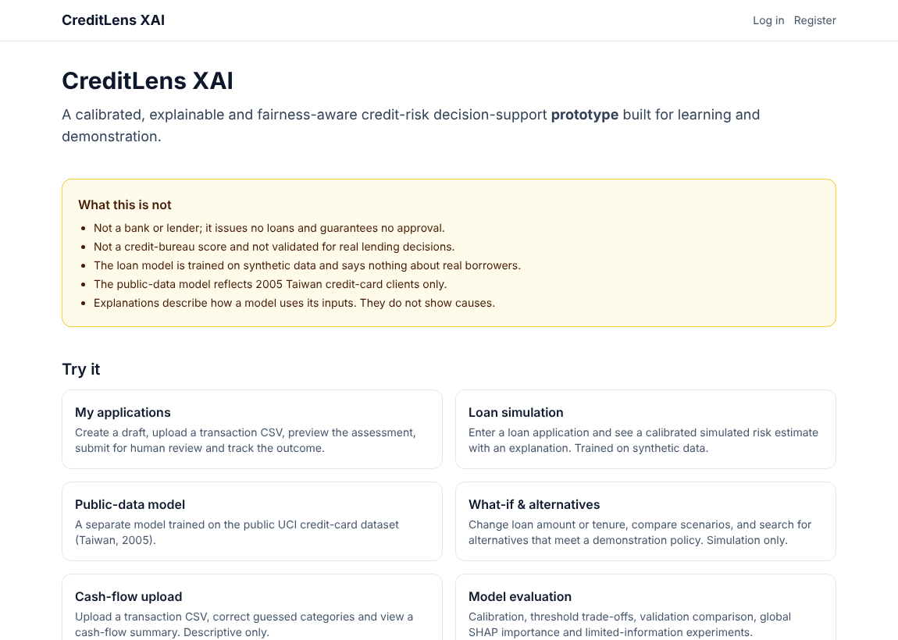
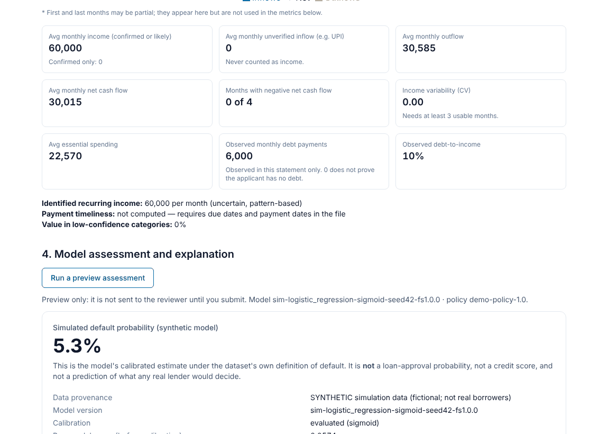
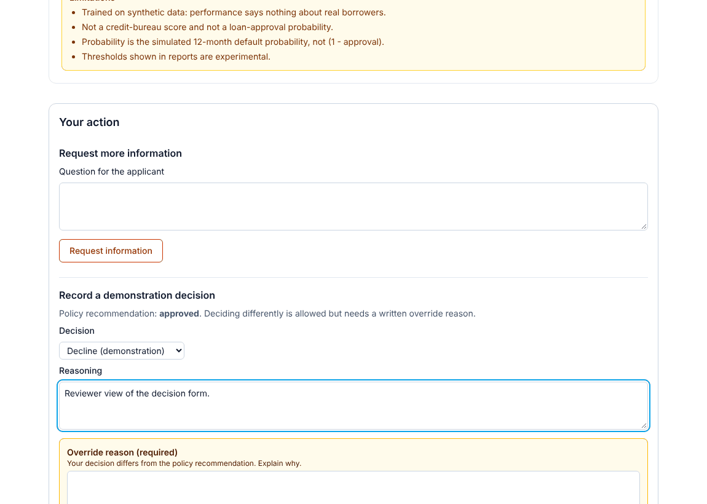
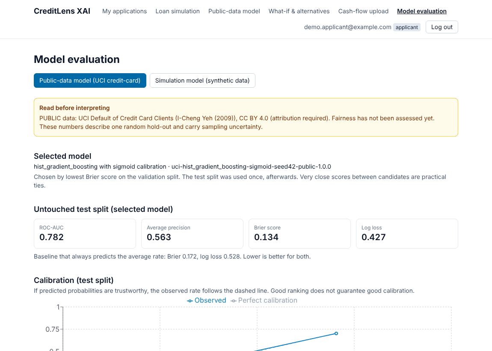
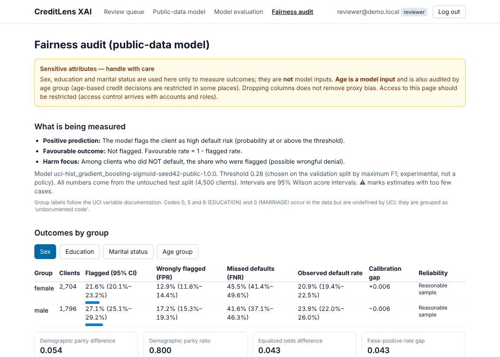
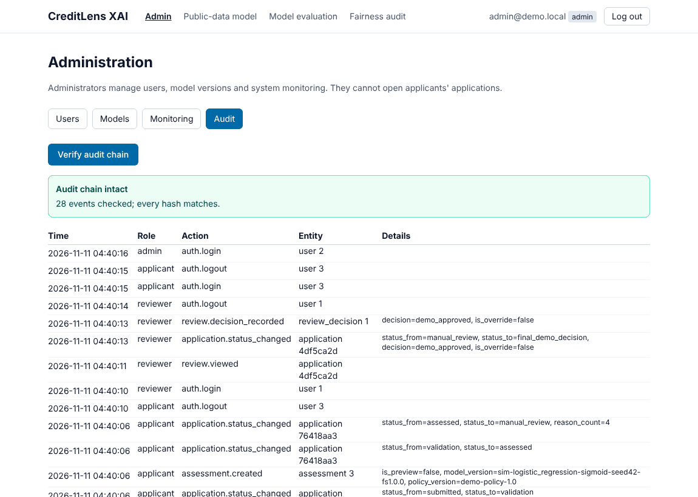

# CreditLens XAI

**A calibrated, explainable and fairness-aware credit-risk decision-support platform** with cash-flow analysis, constrained counterfactuals, a human reviewer workflow and a tamper-evident audit trail.

> **Educational prototype.** Not a bank, not a lender, not a credit-bureau score, and not validated for real lending. The loan model is trained on **synthetic** data; the optional public-data model reflects **2005 Taiwan credit-card clients** only. Nothing here makes or guarantees a real credit decision.

| | | |
|---|---|---|
|  |  |  |
|  |  |  |

*(All screenshots are from the running application using fictional data. More are in `docs/screenshots/`.)*

## What it does
- **Calibrated risk model.** Leak-free pipeline, four-way split (train / calibration / validation / untouched test), three model families x three calibration options compared on validation Brier score, results with baselines and reliability curves.
- **Verified explanations.** SHAP contributions must add up to the model score or the explanation is withheld; plain-language reason codes; applicant view vs reviewer view.
- **Cash-flow engine.** CSV validation, guessed-category provenance with user corrections, income tiers (UPI inflow is never "verified income"), unknown-is-not-zero, kept out of the risk model on purpose.
- **What-if and counterfactuals.** Only controllable terms change; income, age and history never; hypothetical debt reduction is labelled; "no feasible alternative" is a valid answer.
- **Fairness audit.** Fairlearn metrics with 95% intervals, small-group warnings, a mitigation experiment that is analysed but **not deployed**.
- **Human review and governance.** Accounts with roles, applicant -> reviewer workflow as a state machine, mandatory override reasons, model registry with checksums, monitoring, hash-chained audit trail.

## Quick start (Windows PowerShell)
```powershell
# 1. Backend: check files, create the environment, install (first time; shap/scikit-learn take a few minutes)
cd backend
python check_setup.py
python -m venv venv
.\venv\Scripts\Activate.ps1
pip install -r requirements.txt

# 2. Test and train (the UCI dataset is optional, see "Public-data model" below)
python -m pytest -q                 # 210 passed with the dataset; 209 passed + 1 skipped without it
python -m app.train                 # loan model (synthetic data), about 10 seconds

# 3. Create the database, register the model, create demo staff accounts (passwords are printed ONCE)
python -m app.admin init

# 4. Run the API (window 1)
uvicorn app.main:app --reload

# 5. Run the website (window 2)
cd ..\frontend
copy .env.example .env.local
npm install
npm run dev                         # open http://localhost:3000   (use localhost, not 127.0.0.1)
```
**Using it:** register as an applicant, create an application, upload `sample_data\SYNTHETIC_salaried_stable.csv`, run a preview, submit. Log out and log in as `reviewer@demo.local` (password from `admin init`) to record a decision. Log in as `admin@demo.local` for model versions, monitoring and the audit-chain check.

> Keep the repo outside OneDrive (for example `C:\dev\creditlens-xai`): OneDrive can lock or slow the thousands of files in `venv` and `node_modules`. Cookies need the site and the API on the same site: use `localhost` for both.

### Public-data model (optional, needs the dataset)
1. Download the UCI file (CC BY 4.0): <https://archive.ics.uci.edu/dataset/350/default+of+credit+card+clients>
2. Put `default of credit card clients.xls` in `backend\data\` (git-ignored; never committed).
3. From `backend`: `python -m app.public_train`, then `python -m app.fairness`, `python -m app.experiments`, `python -m app.model_card`.

## Project structure
```
backend/    FastAPI app (app/), tests (tests/), Alembic migrations (migrations/), CLI (python -m app.admin)
frontend/   Next.js 16 + TypeScript + Tailwind, 24 components, 86 tests
sample_data/  fictional transaction CSVs (4 personas + a deliberately messy file)
docs/       guides, architecture, deployment, security, model cards, methodology, screenshots
e2e/        optional Playwright journey test
render.yaml Render Blueprint (API + PostgreSQL)
```
Full annotated tree: [`docs/PROJECT_GUIDE.md`](docs/PROJECT_GUIDE.md).

## Documentation
| Document | Read it for |
|---|---|
| [`docs/PROJECT_GUIDE.md`](docs/PROJECT_GUIDE.md) | Every concept, the tech stack and why, structure, business view, future work |
| [`docs/INTERVIEW_QA.md`](docs/INTERVIEW_QA.md) | Interview questions and answers for every part of the project |
| [`docs/ARCHITECTURE.md`](docs/ARCHITECTURE.md) | Diagrams: system, request flow, state machine, data model, ML pipeline |
| [`docs/DEPLOYMENT.md`](docs/DEPLOYMENT.md) | GitHub -> Render (API) + Vercel (website), step by step, troubleshooting |
| [`docs/DEMO_SCRIPT.md`](docs/DEMO_SCRIPT.md) | 7-minute demo and recording plan |
| [`docs/security_and_workflow.md`](docs/security_and_workflow.md), [`docs/security_review.md`](docs/security_review.md) | Roles, controls that exist and do not, tools run, findings |
| [`docs/model_cards/`](docs/model_cards) | Generated model cards (loan model, public-data model) |
| [`docs/explainability.md`](docs/explainability.md), [`docs/scenarios.md`](docs/scenarios.md), [`docs/fairness_and_experiments.md`](docs/fairness_and_experiments.md), [`docs/cashflow_methodology.md`](docs/cashflow_methodology.md) | Method notes |
| [`docs/dataset_provenance.md`](docs/dataset_provenance.md), data dictionaries | Data sources, licences, field definitions |

## Quality evidence
- **296 automated tests:** 210 backend (pytest) and 86 frontend (Vitest + Testing Library). The database tests also pass on **PostgreSQL 16**, via `CREDITLENS_TEST_DATABASE_URL`.
- Black-box sweeps prove all **44 API routes** refuse anonymous callers and enforce roles.
- Static and dependency analysis: Bandit (0 issues), pip-audit and npm audit (no project dependency flagged). Details in `docs/security_review.md`.
- A real-browser run of the full journey (register -> upload -> preview -> submit -> review -> decision -> admin audit) was performed on Linux with Chromium. **Not run on Windows by the author**, and the GitHub Actions workflow has not yet run on GitHub.
- Code coverage has not been measured.

## Deploying
Documented path: Render (API + PostgreSQL via `render.yaml`) and Vercel (website, proxying `/api/*`); see [`docs/DEPLOYMENT.md`](docs/DEPLOYMENT.md). The author has prepared and tested this path locally but has not deployed it yet; add your live URL here once you have.

## Limitations (read these)
Synthetic loan data; single-snapshot 2005 public data with random splits only; unvalidated demonstration thresholds; no MFA, password reset, IP rate limiting, Content-Security-Policy or encryption at rest; free-tier hosting caveats; no independent security review. See [`docs/security_and_workflow.md`](docs/security_and_workflow.md).

## Licence and attribution
Code: MIT (see `LICENSE`). The optional public-data model uses *Default of Credit Card Clients* by I-Cheng Yeh (2009), UCI Machine Learning Repository, **CC BY 4.0**, <https://doi.org/10.24432/C55S3H>. The dataset is not included in this repository.
