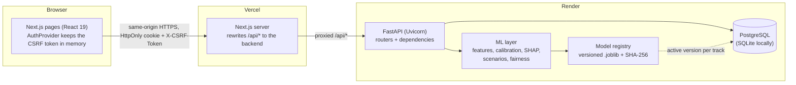
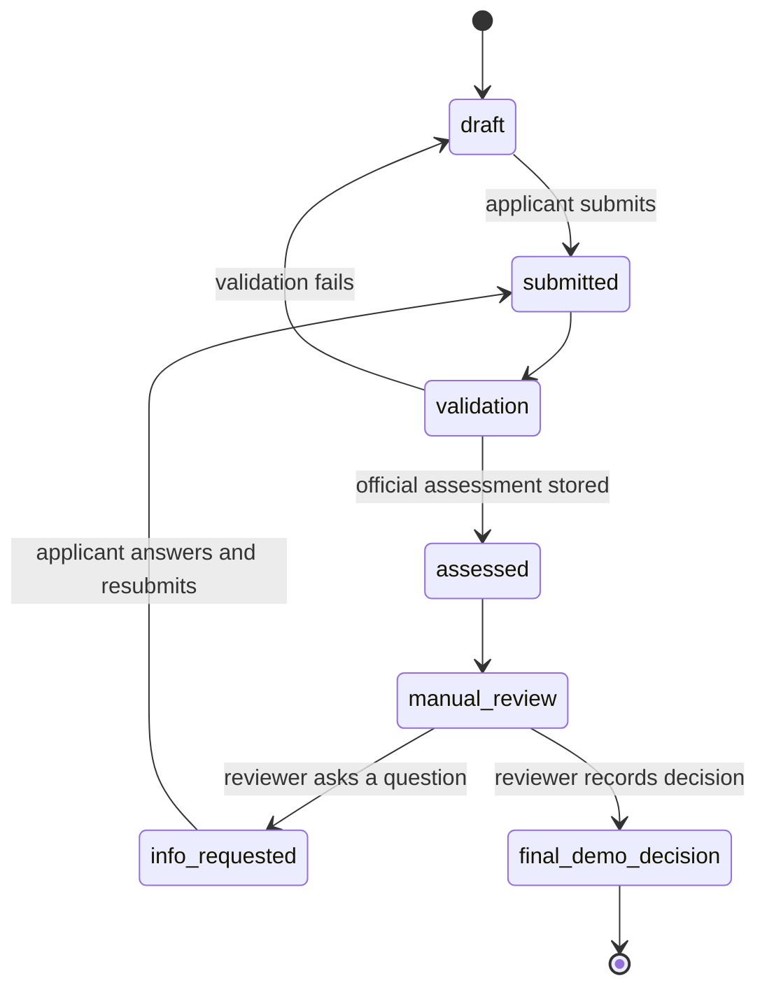
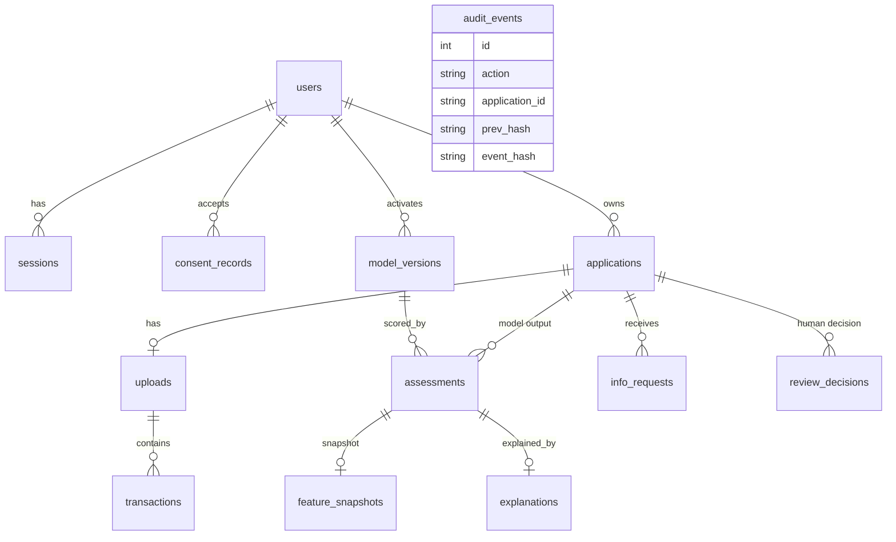
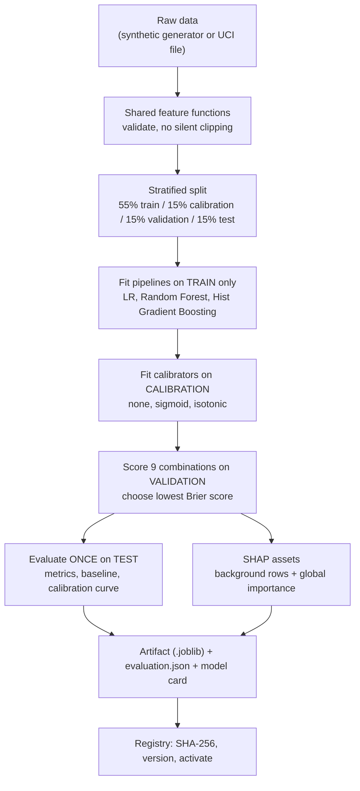

# Architecture

Diagrams are written in Mermaid, which GitHub renders automatically.

## 1. System context



Locally there is no proxy: the page on `localhost:3000` calls the API on `localhost:8000` directly (CORS with credentials; both are the same *site*).

## 2. Layers inside the backend (`backend/app`)

| Layer | Modules | Responsibility |
|---|---|---|
| HTTP | `main.py`, `routes_auth.py`, `routes_applications.py`, `routes_reviews.py`, `routes_admin.py` | Validate input (Pydantic), call services, shape responses. No business rules here. |
| Security | `deps.py`, `security.py` | Session lookup, CSRF + Origin checks, role guards, Argon2id hashing. |
| Domain / workflow | `app_service.py`, `workflow.py`, `policy.py`, `audit.py`, `monitoring.py` | State machine, review routing, submission pipeline, demo policy, hash-chained audit. |
| ML | `features.py`, `public_features.py`, `train.py`, `public_train.py`, `calibration.py`, `explain.py`, `scenarios.py`, `fairness.py`, `experiments.py` | Shared feature code, training, calibration, SHAP, what-if/counterfactuals, fairness, experiments. |
| Data input | `ingestion.py`, `categorizer.py`, `cashflow.py` | CSV validation, categories, cash-flow analytics. |
| Persistence | `db.py`, `models.py`, `migrations/` | SQLAlchemy models, engine, Alembic migrations. |
| Operations | `registry.py`, `admin.py`, `model_card.py`, `config.py` | Model versions, CLI (`init`, `bootstrap`, `create-user`), model cards, environment config. |

Rule of thumb: **routes call services; services call ML and the database; ML code never touches HTTP or the database.**

## 3. One submission, end to end

```mermaid
sequenceDiagram
    participant B as Browser
    participant V as Vercel proxy
    participant A as FastAPI
    participant D as Dependencies
    participant S as app_service
    participant R as Registry
    participant M as Model + SHAP
    participant DB as Database
    B->>V: POST /api/v1/applications/{id}/submit (cookie + X-CSRF-Token)
    V->>A: forwarded request
    A->>D: authenticated_user, applicant_user
    D->>DB: find session by SHA-256(token); check expiry, active user
    D-->>A: user (or 401/403); CSRF + Origin verified
    A->>S: submit_application
    S->>R: load_active_bundle (checksum verified)
    S->>DB: draft -> submitted -> validation (audited)
    S->>M: predict_one + explanation (additivity checked)
    S->>DB: Assessment + FeatureSnapshot + Explanation
    S->>DB: assessed -> manual_review, review reasons (audited)
    A-->>B: application view (applicant-safe: no full SHAP table)
```

## 4. Application state machine


Applicants can edit only in `draft` and `info_requested`. They can delete in `draft`, `info_requested` and `final_demo_decision` (not while a reviewer may be working).

## 5. Data model


`audit_events` deliberately has **no foreign keys**: the audit record must survive deleting an application or user.

## 6. ML pipeline (training time)



## 7. Design decisions in one line each
- **One feature function** for training, serving and scenarios, so train/serve skew cannot exist.
- **Model, policy, human** are three separate things: model output (`assessments`), rules (`policy.py`), decision (`review_decisions`).
- **Unknown is never zero**: missing credit history and undefined ratios are `null`/`NaN` with explicit indicators.
- **Server-side authorization for everything**; UI guards are convenience only.
- **Sessions in the database, not JWTs**: revocable, role changes take effect immediately.
- **Tamper-evident audit**: each event hashes the previous one.
